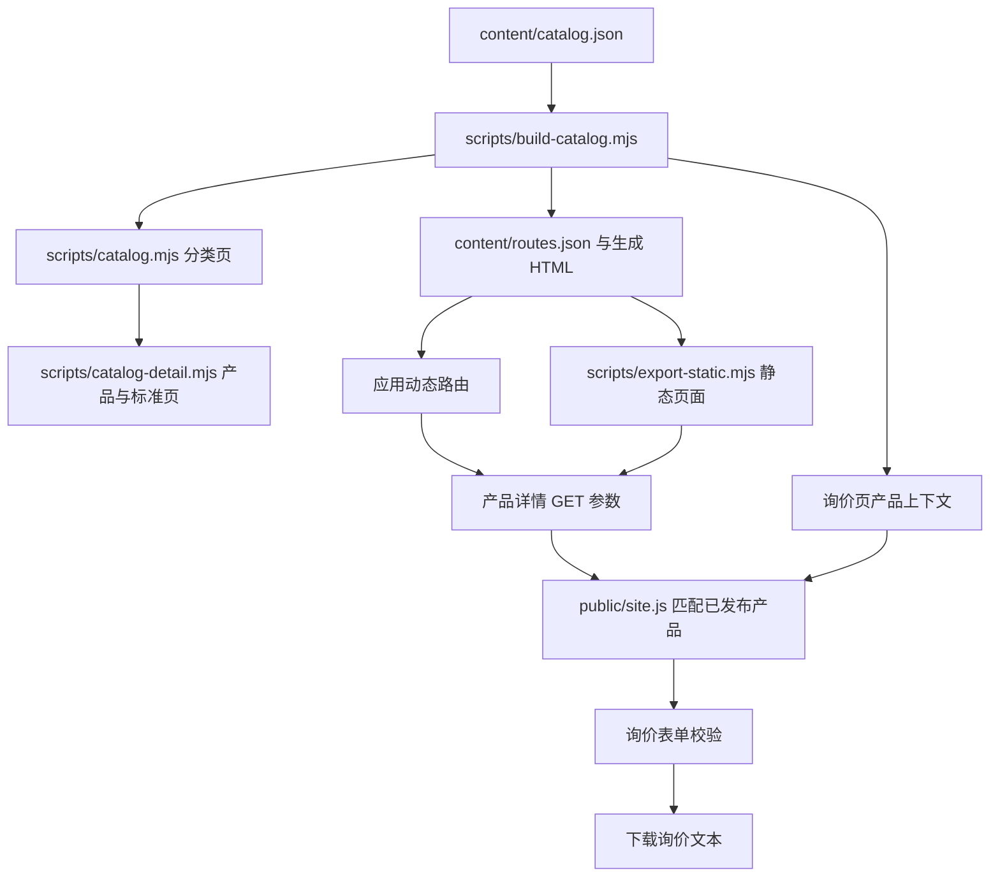

# 内六角沉头螺钉：完整页面与询价流程

## 访问路径

1. `/products` → `/products/screws`：螺钉总览。
2. `/products/countersunk-screws` 或 `/products/hex-socket-screws`：从头型或驱动形式进入。
3. `/product/hex-socket-countersunk-screw`：唯一产品详情、示意图、规格参考、注意事项和询价参数输入。
4. `/standards/iso-10642`：标准说明，关联回产品；`/standards` 的 ISO 区块也可进入。
5. `/rfq?product_id=hex-socket-countersunk-screw`：显示来源产品并填入名称、标准。详情页配置表单可同时传入直径、长度、材质、性能等级、表面处理、数量。
6. 填写联系信息、数量和其他要求后，校验表单并生成可下载的询价文本。

支持 `?lang=zh-CN` 等现有九种语言；页面链接和详情表单都保留语言选择。静态导出使用相对链接与相对 form action，可通过 HTTP 或本地文件访问。

## 数据及代码调用链

`categoryIds` 让一条产品数据显示在两类中，父类汇总去重。`detail` 生成产品说明及参数输入表单，`standardId` 关联顶层 `standards` 数据。草稿产品不生成详情和询价入口。

询价页通过已知产品 ID 读取名称与标准；未知 ID 不触发自动填充。仅接收直径、长度、螺距、材质、性能等级、表面处理、数量这些参数，每项最多 160 字符。参数写入 input.value，不拼接为 HTML。切换语言会更新自动填入的产品名称，但保留用户已修改的名称。

## 资料与业务边界

- 参考 [ISO 10642:2026](https://www.iso.org/standard/90795.html)，记录现行版、M2–M20 公制粗牙范围及承载能力降低的说明。
- 参考 [Bossard DIN 7991 产品资料](https://www.bossard.com/us-en/eshop/screws-and-bolts-with-internal-drive/hex-socket-flat-countersunk-head-screws-fully-threaded/p/20/)，注明 DIN 7991 已撤销，替代前需确认尺寸与用途。
- 图片为原创 SVG 示意图，不是工厂实拍或制造尺寸图。
- 标准范围不代表已确认供货范围。页面未承诺库存、价格、最小起订量或交期。
- 询价沿用本地预览下载模式：不向服务器提交、不发送邮件、不上传附件。文件名可写入询价文本，附件本身不包含在文本文件内。

## 验证

`npm run test:flow`：生成静态站点并检查多分类去重、详情与标准关系、草稿行为、相对表单路径及九种语言。

`npm test`：完整应用构建、静态导出和全部测试；需要完整安装项目依赖。

浏览器检查应覆盖：从两个分类进入同一详情、标准页返回、填写参数后进入询价、语言保留、必填字段校验、询价单下载、未知产品 ID、手机宽度及离线相对路径。
